import Since from '../../../../components/Since.astro';
import { Steps, LinkCard, CardGrid } from '@astrojs/starlight/components';
import Term from '../../../../components/Term.astro';

Gram does not simply read recipes top to bottom: it actively calculates their optimal timeline to save you valuable time in the kitchen.

To achieve this, the engine relies on a reverse scheduling algorithm called **ALAP (*As Late As Possible*)**. This ensures every ingredient or intermediate component finishes right when the next step requires it, preventing delicate items from sitting idle on the counter.

## The problem: naive forward scheduling

Consider a classic recipe combining dough that needs 1 hour to rise, a quick sauce requiring 10 minutes of active prep, and a final bake:

```gram
[Knead] Mix @flour with @water and let rise ~_{1h}. ->&dough

[Stir] Combine @tomato sauce{} and @basil ~{10min}. ->&sauce

[Bake] Bake &dough with &sauce in the oven ~_{30min}.
```

With naive forward scheduling (starting each task as early as possible), the timeline has an obvious flaw:

```mermaid
gantt
    title Naive forward scheduling (50 min idle wait)
    dateFormat  m
    axisFormat %M
    
    section Dough
    Knead (active work)                 : active, a1, 0, 2m
    Dough rise (passive timer)          : a2, after a1, 60m
    
    section Sauce
    Stir (active work)                  : active, a3, after a1, 10m
    Sauce sits idle (50 min wasted)     : crit, a4, after a3, 50m
    
    section Bake
    Bake in oven (passive timer)        : a5, after a2, 30m
```



The sauce is ready at minute 12, but dough rising finishes only at minute 62. The sauce sits idle on the counter for 50 minutes, separating or cooling down.

## The solution: reverse ALAP scheduling

Instead of starting tasks as early as possible, Gram's compiler works **backward** from the final serving deadline.

When the engine detects that `[Bake]` consumes both `&dough` and `&sauce`, it calculates their exact completion deadline. It then shifts sauce preparation to the latest possible start time, ensuring it concludes *precisely* when dough fermentation ends:

```mermaid
gantt
    title ALAP scheduling (Gram — Masked time execution)
    dateFormat  m
    axisFormat %M
    
    section Dough
    Knead (active work)                 : active, b1, 0, 2m
    Dough rise (passive timer)          : b2, after b1, 60m
    
    section Sauce
    Stir (active work)                  : active, b3, 52, 10m
    
    section Bake
    Bake in oven (passive timer)        : b4, after b2, 30m
```



*(Note: when an active step lacks an explicit timer, Gram allocates a default 2-minute active duration).*

By aligning sauce completion with the end of dough fermentation, Gram nests active prep **inside** the passive wait. Your tasks flow naturally, overall time is minimized, and preparations remain at peak freshness.

## Shared cookware and named tracks

Gram's ALAP engine natively manages shared physical resources through **named tracks**. When you assign the same track identifier to multiple passive timers (e.g. `~_oven{20min}` and `~_oven{30min}`), Gram enforces sequential execution on that specific piece of equipment.

This constraint ripples backwards through the timeline: upstream active preparation tasks are scheduled so that the oven remains continuously utilized without idle gaps:

```mermaid
gantt
    title Sequential execution on named equipment track (~_oven)
    dateFormat  m
    axisFormat %M
    
    section Tart Track
    Prep tart (active)                : active, p1, 0, 5m
    Bake tart (~_oven)                : p2, after p1, 20m
    
    section Bread Track (interleaved by ALAP)
    Prep bread (active)               : active, b1, 20, 5m
    Bake bread (~_oven)               : b2, after p2, 30m
```



`Prep bread` is automatically scheduled during tart baking (minutes 20 to 25): bread is ready to bake the exact moment the tart leaves the oven at minute 25.

## Modular anchoring (`@use ... ~{-1d}`)

When assembling modular recipes with `@gram-lang/modules`, you can attach a retro-planning offset directly to an import directive:

```gram
@use "@/components/bases/sourdough-starter.gram" as &starter ~{-2d}
```

ALAP scheduling propagates this anchor backwards across the entire imported recipe graph:
- The section producing `&starter` is pinned to finish **2 days before** main assembly.
- All upstream steps within the starter module (refreshing, fermenting) are scheduled earlier accordingly.
- During final compilation, the global timeline is shifted forward so that all timestamps begin at 0.

## Best practices for a fluid timeline

To maximize the efficiency of Gram's ALAP scheduling engine, follow these practical rules:

<Steps>
1. **Differentiate active work and passive timers (`~_`)**  
   Whenever a step does not require hands-on attention (baking, rising, chilling, simmering unattended), always use a passive timer (`~_`). Using an active timer by mistake (`~{1h}` instead of `~_{1h}`) signals to Gram that your hands are busy for the entire hour, blocking masked-time task interleaving.

2. **Declare early, consume late**  
   Declare intermediate ingredients (`->&name`) as soon as active preparation concludes, and reference them (`&name`) only in the step where they are incorporated. Gram stretches the interval between production and consumption automatically.

3. **Use named tracks for shared physical equipment**  
   If you have a single oven for multiple preparations, group them under a common track (`~_oven{10min}`, `~_oven{30min}`). Without a named track, Gram assumes independent equipment and schedules them in parallel.

4. **Define realistic step boundaries**  
   Steps without timers receive a default 2-minute active duration. Model coherent kitchen actions rather than micro-steps to prevent artificially inflating cumulative active time.
</Steps>

## From algorithm to schedule

ALAP scheduling produces the foundational timeline (`layout()`). This structure serves as the basis for all presentation and planning options:

- **Mise en place strategies**: by section (in masked time), upfront, or per working day.
- **Multi-day recipes**: automated day division via day anchors (`~{-1d}`, `~{-2d}`).
- **Real-time calendar projection**: dynamically fitting tasks into your kitchen availability and serving target.

To explore these capabilities and see how they form the <Term id="runSheet" />, see the dedicated deep dive [Planning and run sheets](/docs/explanation/planning/).

## Related resources

<CardGrid>
  <LinkCard
    title="Planning and run sheets"
    description="Mise en place strategies, multi-day recipes, calendar projection, and run sheet generation."
    href="/docs/explanation/planning/"
  />
  <LinkCard
    title="Plan a meal"
    description="Step-by-step practical guide: CLI commands, Markdown export, and calendar synchronization (.ics)."
    href="/docs/how-to/plan-a-meal/"
  />
  <LinkCard
    title="Times and durations syntax"
    description="Declare active durations, passive timers, named tracks, and day anchors."
    href="/docs/reference/syntax/times/"
  />
  <LinkCard
    title="The scheduling engine"
    description="Architecture of the @gram-lang/scheduler package, task graph, and pure functions."
    href="/docs/explanation/engine/scheduler/"
  />
</CardGrid>
