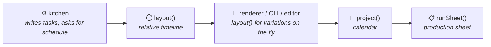

import Since from '../../../../../components/Since.astro';
import { Steps, LinkCard, CardGrid } from '@astrojs/starlight/components';
import Term from '../../../../../components/Term.astro';

<Since v="1.4.0" />

`@gram-lang/scheduler` is the component in Gram responsible for the temporal dimension: it determines **precisely when** each task must be executed. Until version 1.4.0, this logic was part of the Kitchen compiler. It is now isolated in its own package, allowing the same engine to serve the compiler, renderer, CLI, Language Server (LSP), and your custom integrations.

The scheduler sits **beneath** the Kitchen: `@gram-lang/kitchen` depends on it, never the other way around. It has no knowledge of the AST, the `.gram` syntax, or the compiled recipe. Its only input is an agnostic **task graph**, and architecture tests strictly forbid importing any other Gram package into it.

## The task graph

Kitchen writes this graph into the compiled recipe (`tasks`): it contains the intrinsic facts of the recipe, independent of any scheduling or display options:

- **`prep` tasks**: the work required to prepare a section. Each section has a preparation task for gathering and weighing its raw ingredients, plus one per intermediate variable consumed (`&dough`), which cannot begin before that intermediate is ready.
- **`step` tasks**: one per step, corresponding to hands-on active work.
- **`passive` tasks**: the passive timers of a step (baking, rising, resting, chilling…), with the offset at which they start, and an optional track for dedicated equipment (`~_oven{}`).
- **Structured durations**: each task has a duration `{ nominal, min?, max? }`. The `min` and `max` bounds are only present for waits specified as a range (`~_{8-16h}`); `nominal` represents the default duration (the minimum value for a passive timer, the maximum value for an active task, or the fixed duration otherwise).
- **Explicit dependencies**: each task lists the IDs of those it waits for (`after`). IDs are deterministic and human-readable: `s0.prep`, `s1.prep.dough`, `s0.3`, `s0.3.t0`.
- **Section metadata**: each section carries its target working day (`day`), its deadline in minutes before service when anchored, and any intermediate it produces.

Because this graph does not depend on user options, every combination of mise en place strategy and wait elasticity can be recalculated on the fly without recompiling the recipe.

## Two scheduling levels

| Level | Function | Input | Output |
|---|---|---|---|
| **1. Relative timeline** | `layout(graph, options)` | The task graph, and optionally `{ miseEnPlace, rests }` | A `Schedule` (ordered blocks, relative working days, time totals) and diagnostics intrinsic to the recipe |
| **2. Calendar projection** | `project(recipes, context)` | One or more graphs, a serving time, a time zone, and availability | A timestamped plan: each block with its local date and time, adjusted waits, unavailable periods, and unresolved conflicts |
| | `runSheet(plan \| schedule, options)` | The projected plan, or a bare `Schedule` | The days, visits to the kitchen and threads of a <Term id="runSheet" /> (see below) |
| | `findServeTimes()`, `earliestServe()` | A graph, a context, a range of dates or "now" | The serving times that work, and the earliest one |

Both functions are **strictly pure**: identical inputs always yield identical outputs, no system clock or implicit time zone is read, and the input graph remains immutable. `project()` accepts a list of recipes by design, but currently plans only the first one while emitting the `MULTI_RECIPE_UNSUPPORTED` diagnostic.

## How `layout()` works

The engine implements the as-late-as-possible algorithm described in [ALAP scheduling](/docs/explanation/alap-scheduling/), structured in multiple passes:

<Steps>
1. **Backward pass (ALAP)**  
   Traversing sections from last to first, each step receives the latest possible start time based on section anchors and steps that consume its preparations.

2. **Named track allocation**  
   Two timers assigned to the same track (e.g. `~_oven{}`) cannot overlap. The earlier timer is pushed backward to clear the track, and a contention diagnostic (`TRACK_CONTENTION`) is reported.

3. **Rebasing to origin**  
   The entire timeline is shifted so that the initial moment starts exactly at zero.

4. **Inserting mise en place**  
   Preparation work for each group of sections is inserted as dedicated tasks, and the backward pass runs again so that each preparation finishes precisely when the first step requiring it begins. Depending on the chosen strategy:
   - `"perSection"` places preparation right before each section;
   - `"upfront"` groups all preparations at the very start of the recipe;
   - `"perDay"` places preparations at the beginning of each working day.
</Steps>

Waits written as a range follow the strategy specified via `rests` (`"shortest"`, `"balanced"`, or `"longest"`). Active timers always take their nominal maximum duration, ensuring cooking uncertainties never delay the service.

## How `project()` works

`project()` lays the graph out using `layout()`, anchors the final moment at the target serving time, and walks backward along the timeline:

- Any active work stretch falling into unavailable hours is shifted by lengthening or shortening the nearest flexible wait (written as a range) downstream.
- The entire timeline is re-laid out on each adjustment to verify dependencies and track availability against the concrete result.
- For a step-by-step walkthrough, see [Planning and run sheets](/docs/explanation/planning/).

Internal time is counted in continuous absolute minutes since the POSIX epoch. Local time display relies on `Intl.DateTimeFormat` with an explicit time zone. No third-party date library or implicit system clock is involved: the plan remains byte-for-byte identical regardless of host environment, and a 23-hour or 25-hour daylight saving transition day counts for its actual duration.

## From the schedule to the run sheet

The engine produces **pure structural data**; the run sheet is one way to display it. The `runSheet()` function turns a relative timeline or a calendar plan into a tree structure ready for rendering by any user interface, built around a standardized vocabulary:

| Term | Definition |
|---|---|
| **Working day** | A working day dedicated to the recipe. Only a day anchor (`~{-2d}`, declared on a section or an imported `@use` module) creates a distinct working day. In the absence of day anchors, the recipe fits in a single working day. |
| **Visit** | An active cooking period: a continuous sequence of manual hands-on steps unbroken by substantial idle periods (any passive rest of 60 minutes or longer, controlled by `VISIT_GAP_MINUTES`, marks the end of a visit). A working day may contain several visits. |
| **Thread** (*fil*) | A passive process (baking, resting, proofing) initiated during a visit and continuing unattended after you leave the kitchen. |
| **Adjustment** | A rest period lengthened or shortened during projection, within its declared range, to align active hands-on blocks with your available hours (`avoid-unavailable`). |
| **Unresolved problem** | A diagnostic emitted during projection when a timing constraint cannot be satisfied. |
| **Margin** | The window of anticipation by which a visit can be executed early, assuming all other visits are performed at their nominal scheduled times. |

Every metric is calculated by the engine as relative minutes from serving time, whether in an abstract schedule or a concrete timestamped calendar.

The anticipation margin quantifies how far a visit can be shifted earlier without disrupting the rest of the recipe:
- Because scheduling works as late as possible (ALAP), a visit can only ever be moved earlier, never delayed without pushing back serving time;
- Moving it earlier shortens the preceding passive wait and extends the succeeding one, within their declared ranges;
- If an actual delay occurs during cooking, the engine does not retroactively rewrite past events: simply run a fresh projection with an updated target time.

How these details are presented is up to the viewing layer. Gram's default [run sheet](/docs/how-to/plan-a-meal/) splits a day whenever a passive rest reaches one hour, displays margins starting at 15 minutes, and extracts ingredients and equipment from the compiled recipe. Custom applications are free to adopt different visual conventions using the exact same underlying data (see [Build a custom UI](/docs/how-to/build-custom-ui/)).

### What the engine does not support

- **One recipe at a time**: Planning a multi-recipe menu simultaneously with shared physical tracks is planned for a future release (`MULTI_RECIPE_UNSUPPORTED`).
- **No background live replanning**: Because scheduling is a deterministic, pure function of its inputs, an actual delay requires invoking the engine again with updated parameters.
- **No arbitrary decisions**: The engine evaluates candidate serving times provided by the user (`findServeTimes()` targeting usual meal times, or `earliestServe()` starting right now), reporting which slots succeed and why others fail.

## Two diagnostic families

The engine strictly separates two categories of issues:

- **Intrinsic recipe diagnostics**: detected during layout by `layout()` (`TIME_PARADOX`, `TRACK_CONTENTION`, `DAY_OVERFLOW`). Kitchen transforms them into compiler warnings (`WarningCode`), enriched with section titles and source locations for display in editor tooling.
- **Contextual projection diagnostics**: these only arise once the serving time and user availability are evaluated against the recipe (`ACTIVE_OUTSIDE_AVAILABILITY`, `ACTIVE_BLOCK_EXCEEDS_AVAILABILITY`, `DAY_MISMATCH`, `START_IN_PAST`, `MULTI_RECIPE_UNSUPPORTED`). They form part of the result returned by `project()` and are not compilation warnings.

## In the pipeline

Downstream views (the default run sheet or custom UI components) sit **after** the engine and consume its data structures directly. See the [scheduler API reference](/docs/reference/api/scheduler/) for complete function signatures and TypeScript types.

## Related resources

<CardGrid>
  <LinkCard
    title="Planning and run sheets"
    description="Mise en place strategies, multi-day recipes, calendar projection, and run sheet generation."
    href="/docs/explanation/planning/"
  />
  <LinkCard
    title="ALAP scheduling"
    description="Understand the reverse planning algorithm that optimizes passive and active tasks."
    href="/docs/explanation/alap-scheduling/"
  />
  <LinkCard
    title="Plan a meal"
    description="Step-by-step practical guide: CLI commands, Markdown export, and calendar synchronization (.ics)."
    href="/docs/how-to/plan-a-meal/"
  />
  <LinkCard
    title="Scheduler API reference"
    description="Function signatures, options, and TypeScript types for layout(), project(), and runSheet()."
    href="/docs/reference/api/scheduler/"
  />
</CardGrid>
