import Since from '../../../../components/Since.astro';
import { Steps, LinkCard, CardGrid } from '@astrojs/starlight/components';
import Term from '../../../../components/Term.astro';

<Since v="1.4.0" />

A recipe describes **what it requires** and **how each step is carried out**: ingredients, cookware, active steps, and timings. However, it does not dictate how you organize your time in the kitchen.

Switching planning strategies never changes the required ingredients, the shopping list, estimated preparation times, or actual active cooking work. It solely rearranges the timeline of tasks to match your schedule and availability.

## Three concepts, one choice

To understand how Gram handles time, consider three distinct dimensions:

| Concept | Role | Changed by planning choices? |
|---|---|---|
| **Ingredients** | The raw materials required by each section and the consolidated shopping list. | No |
| **Mise en place** | Upfront preparation work: measuring, washing, peeling, chopping. Each section reports its estimated cost (`miseEnPlace`). | No |
| **Planning** | The chronological layout of tasks: relative timeline, total duration, and the <Term id="runSheet" />. | **Yes**, this is the only dimension modified. |

Gram automatically derives these aspects directly from your recipe markup. No manual calculations are needed.

## The three mise en place strategies

Consider a simple recipe with dough and filling:

```gram
## Dough ->&dough

[Mix] Mix @flour{500g} and @water{300ml} in a #bowl.

[Rise] Let it rest ~_{30min}.

## Filling ->&filling

[Slice] Slice @onions{200g}(finely sliced).

## Assembly

[Combine] Combine &dough and the &filling, then bake ~{25min}.
```

Gram calculates preparation time for each section based on ingredients and cookware (here: 3 min for dough, 3 min for filling, 2 min for assembly, totaling 8 min). Cumulative active cooking work remains 29 minutes in all cases.

Three options determine how preparation is scheduled:

### 1. By section (`perSection`, default)

Preparation for each section is placed as close as possible to its execution. Whenever passive downtime occurs (proofing, resting, baking), Gram schedules subsequent prep during that window in **masked time**: active work performed *during* a passive timer adds zero extra minutes to overall duration.

```mermaid
gantt
    title By section — Masked time execution (1 h 00)
    dateFormat  HH:mm
    axisFormat %H:%M
    todayMarker off
    section Dough
    Mise en place                     : p1, 00:00, 3m
    Mix                               : active, a1, 00:03, 2m
    Rest (passive)                    : r1, 00:05, 30m
    section Filling
    Mise en place                     : p2, 00:28, 3m
    Slice                             : active, a2, 00:31, 2m
    section Assembly
    Mise en place                     : p3, 00:33, 2m
    Combine and bake                  : active, a3, 00:35, 25m
```



The dough rests for 30 minutes. Toward the end of this rest (from 00:28), filling and assembly prep happen just in time: prepped ingredients stay fresh without crowding counter space, and total time is minimized (**1 h 00**).

### 2. Upfront (`upfront`)

All measuring and chopping of raw ingredients takes place before starting any cooking steps:

```mermaid
gantt
    title Upfront — Grouped preparation (1 h 03)
    dateFormat  HH:mm
    axisFormat %H:%M
    todayMarker off
    section Mise en place
    Dough                             : p1, 00:00, 3m
    Filling                           : p2, 00:03, 3m
    section Dough
    Mix                               : active, a1, 00:06, 2m
    Rest (passive)                    : r1, 00:08, 30m
    section Filling
    Slice                             : active, a2, 00:34, 2m
    section Assembly
    Retrieve preparations             : p3, 00:36, 2m
    Combine and bake                  : active, a3, 00:38, 25m
```



Dough and filling prep occur together at 00:00. Total duration increases to **1 h 03**, as filling preparation is no longer masked during dough fermentation. This mode suits cooks who prefer clearing their workstation before turning on the heat.

### 3. Per working day (`perDay`)

Preparation is consolidated at the start of each working day. For single-day recipes, this produces the exact same layout as upfront preparation. Its true power shines in multi-day recipes.

:::note[Handling intermediate preparations]
An intermediate ingredient (`&dough`) does not exist at the start of a recipe: it cannot be prepared before being produced. Regardless of the chosen mode, fetching or measuring an intermediate is always attributed to the section that **consumes** it, scheduled right when that step begins.
:::

## Configuring options across tools

Gram enforces a strict rule: a recipe contains no presentation flags or rigid scheduling directives. It only states culinary facts. Readers and cooks choose their preferred mise en place mode and resting strategy when viewing or rendering:

| Tool | Mise en place mode | Rest strategy |
|---|---|---|
| **CLI** (`gram view`, `plan`, `export`, `print`) | `--mise-en-place <per-section\|upfront\|per-day>` | `--rests <shortest\|balanced\|longest>` |
| **VS Code** | Setting `gram.miseEnPlace` | Setting `gram.rests` |
| **Playground** | "Mise en place" selector | "Rests" selector |
| **Renderer** (`@gram-lang/renderer`) | Option `miseEnPlace` | Option `rests` |

In compiled JSON, `schedule` contains the default timeline (by section, shortest rests). Alternative schedules are calculated on the fly from `tasks` using `@gram-lang/scheduler`'s pure `layout()` function, without recompiling the recipe.

## Passive timers and elasticity

Passive durations can be fixed (`~_{12h}`) or specified as an **elastic range** (`~_{12-24h}`).

A range indicates an acceptable window: ready in 12 hours, preserving optimal quality up to 24 hours. This elasticity allows Gram to adjust schedules without compromising the recipe:

- **On theoretical timelines**, the `rests` option sets default behavior:
  - `shortest` (default): chooses the lower bound;
  - `balanced`: chooses the midpoint;
  - `longest`: chooses the upper bound.
- **On real-calendar schedules**, this elasticity lets the engine extend or compress waiting periods so active cooking never falls in the middle of the night.

Active ranges (`~{40-50min}`) indicate cooking uncertainty rather than elasticity: they are always scheduled at their maximum nominal duration to guarantee you never serve late.

## Multi-day recipes and day anchors

Long recipes (sourdough bread, pastries, laminated dough, cured meats) naturally span multiple working days.

```gram
---
title: Layered tart
---

## Custard ~{-3d} ->&custard

[Whisk] @milk{500ml} and @eggs{4}.

[Chill] Chill at ^{4C} for ~_{24h}.

## Crust ->&crust

[Knead] Work &custard{150g} with @flour{300g} and @butter{150g}.

## Tart ~{-1d}

[Fill] Fill with &crust{400g}.

[Bake] For ~{30min}.

## Serve

[Dust] Dust with @sugar{10g}.
```

Structuring multi-day recipes relies on two straightforward principles:

1. **Only day anchors (`~{-Nd}`) open working days.** Anchors such as `~{-1d}` or `~{-2d}` state clear intent (*"prep done the day before (D-1)"* or *"two days ahead (D-2)"*). In contrast, hour anchors (`~{-18h}`) or standalone long timers (`~_{24h}`) push tasks upstream along the timeline, but never open autonomous calendar days.
2. **Unanchored sections attach to the next anchor.** Because scheduling works backward from serving time, an unanchored section is placed as late as possible—sharing the same working day as the anchored section following it. In the example above, the crust has no anchor, so it is made on **D-1**, immediately before the tart.

For this recipe, Gram outputs:

```text
D-3      ▮ ~ 5min        Custard
         ┆ Custard : Chill 1d
D-1      ▮ ~ 40min       Crust, Tart
Day D    ▮ ~ 5min        Serve
         ★               Serve
```

:::tip[Consecutive sections on the same day]
When multiple sections occur on the same day, anchor only the last one (`## Tart ~{-1d}`). Preceding sections attach to it cleanly without timeline conflicts.
:::

Each working day fits within a theoretical 24-hour window. If an excessively long passive wait pushes active steps further back beyond this window, Gram emits a `DAY_OVERFLOW` compiler warning and suggests anchoring the section one day earlier (`~{-2d}`).

## Real-time calendar planning

A relative timeline tells you how long a recipe takes. To find out **when to start**, Gram matches this model against three inputs:

1. **Target serving time** (`--serve "2026-10-18 13:00"`).
2. **Time zone** (`--tz Europe/Paris`, or the project `timezone` setting).
3. **Kitchen availability** (`--available`, or the project `availability` setting).

### Defining your availability

The availability syntax is concise and flexible:
- `08:00-22:00`: daily default window;
- `sat=09:00-23:00`: weekday exception (`mon` through `sun`);
- `2026-10-09=none`: complete unavailability on a specific calendar date;
- `22:00-02:00`: a range whose end time precedes its start time crosses midnight continuously.

A specific date override takes precedence over a weekday rule, which in turn overrides the daily default.

:::note[Time zones and daylight saving]
Internal calculations use continuous absolute minutes. A 24-hour dough rise crossing a daylight saving transition lasts 24 real hours: if it begins at 14:00 the day before, it finishes at 13:00 local clock time. No timezone quirks distort culinary precision.
:::

### How Gram avoids overnight cooking

The engine anchors the end of the recipe to the serving time, then works backward:

<Steps>
1. **Detecting overlaps**  
   Continuous active tasks without pauses form indivisible blocks. Any block overlapping unavailable periods (such as 22:00 to 08:00) is flagged.

2. **Adjusting through elastic rests**  
   To move active work into your available hours, Gram extends or shortens the nearest downstream elastic rest (`~_{8-16h}`). Extending a rest pushes prep earlier (e.g. to the evening before); shortening it shifts it to the next morning.

3. **Strict verification**  
   The entire timeline is recalculated with every adjustment. Gram never exceeds defined range bounds and never alters fixed timers.
</Steps>

### Example: overnight fermentation

```gram
## Dough ->&dough

[Knead] Knead @flour{500g} and @water{350ml} for ~{20min}.

[Rise] Let rise ~_{8-16h}.

## Bake

[Bake] Shape &dough{850g} and bake ~{30min}.
```

For Sunday lunch at 13:00 with availability from `08:00-22:00`, a minimal 8-hour rise would schedule kneading at 04:10 AM.

Using the `8-16h` range, Gram automatically extends the rise to 14 h 30 min. Kneading shifts to Saturday night at 21:40, finishing right at 22:00 before bed:

```text
SAT. 10  ▮ 21:40 – 22:00 Dough
         ┆ Dough : Rise 14h 30min (nominal 8h to 16h)
SUN. 11  ▮ 12:30 – 13:00 Bake
         ★ 13:00         Serve
```

## From calendar to run sheet

Calendar projection provides all the operational data needed during cooking. The <Term id="runSheet" /> renders this data:

- **Kitchen visits (`▮`)**: each hands-on cooking session, showing start time, end time, and available advance margin ("Possible from...").
- **Passive waiting threads (`┆`)**: unattended tasks (baking, chilling, fermentation) progressing while you step out of the kitchen.
- **Detailed mise en place**: for each visit, ingredients to measure, preparations to retrieve, and cookware to set up.

Without a target serving time (`gram plan recipe.gram`), Gram outputs a relative countdown (`D-2`, `D-1`, `Day D`) showing estimated durations per day and the earliest possible tasting time (`earliestServe`) starting immediately. Margins and calendar adjustments only apply when a target serving time is set.

### Diagnostics and unresolved constraints

When real-world constraints cannot be met (availability too narrow, or a fixed timer forcing overnight work), Gram presents them under a **"To fix"** header:

| Diagnostic | Meaning | Recommended action |
|---|---|---|
| `ACTIVE_OUTSIDE_AVAILABILITY` | Active work lands outside available hours, with no elastic timer capable of shifting it. | Expand availability windows or widen the elastic timer range. |
| `ACTIVE_BLOCK_EXCEEDS_AVAILABILITY` | An unbroken active task block is longer than your largest availability window. | Lengthen available cooking hours to fit the uninterrupted task. |
| `DAY_MISMATCH` | A task landed on a different date than intended (for example, unanchored work pushed to the day before). | Informational: the schedule remains valid, or explicitly anchor the section if desired. |
| `START_IN_PAST` | The first step would have needed to start before the current time. | Push the serving time later or shorten waiting times. |
| `MULTI_RECIPE_UNSUPPORTED` | Multiple recipes were supplied together; only the first was planned. | Plan recipes individually. |

:::note[Planning diagnostics vs compilation errors]
These diagnostics depend strictly on **your calendar constraints**: they do not represent syntax or compilation errors in your `.gram` recipe file.
:::

## Next steps

<CardGrid>
  <LinkCard
    title="Plan a meal"
    description="Step-by-step guide: CLI commands, Markdown export, and calendar synchronization (.ics)."
    href="/docs/how-to/plan-a-meal/"
  />
  <LinkCard
    title="ALAP scheduling"
    description="Understand the reverse scheduling algorithm that optimizes active and passive workflow."
    href="/docs/explanation/alap-scheduling/"
  />
  <LinkCard
    title="The scheduling engine"
    description="Architecture of the @gram-lang/scheduler package, task graph, and pure functions."
    href="/docs/explanation/engine/scheduler/"
  />
  <LinkCard
    title="Scheduler API reference"
    description="TypeScript types and function signatures for layout(), project(), and runSheet()."
    href="/docs/reference/api/scheduler/"
  />
</CardGrid>
