import Since from '../../../../../components/Since.astro';
import { Steps, LinkCard, CardGrid } from '@astrojs/starlight/components';
import Term from '../../../../../components/Term.astro';

Gram ne se contente pas d'interpréter les recettes de haut en bas : il calcule activement leur ordonnancement optimal pour vous faire gagner un temps précieux en cuisine.

Pour y parvenir, le moteur s'appuie sur un algorithme d'ordonnancement rétrograde nommé **ALAP (*As Late As Possible* — au plus tard possible)**. Ce principe garantit que chaque ingrédient ou préparation intermédiaire est achevé exactement au moment où l'étape suivante en a besoin, évitant qu'un composant ne patiente et ne s'altère inutilement sur le plan de travail.

## Le problème : l'ordonnancement au plus tôt

Considérons une recette classique associant une pâte nécessitant 1 heure de levée, une sauce rapide demandant 10 minutes de préparation active, et une cuisson finale de l'ensemble :

```gram
[Pétrir] La @farine avec l'@eau et laisser lever ~_{1h}. ->&pâte

[Mélanger] Les la @purée de tomate{} et le @basilic ~{10min}. ->&sauce

[Cuire] La &pâte avec la &sauce au four pendant ~_{30min}.
```

Avec un ordonnancement linéaire naïf exécuté dès que possible (*Forward Scheduling*), la chronologie présenterait une rupture majeure :

```mermaid
gantt
    title Ordonnancement naïf au plus tôt (50 min d'attente inutile)
    dateFormat  m
    axisFormat %M
    
    section Pâte
    Pétrir (travail actif)              : active, a1, 0, 2m
    Pousse de la pâte (temps passif)    : a2, after a1, 60m
    
    section Sauce
    Mélanger (travail actif)            : active, a3, after a1, 10m
    Sauce en attente (50 min inutiles)  : crit, a4, after a3, 50m
    
    section Cuisson
    Cuire au four (temps passif)        : a5, after a2, 30m
```



Le défaut saute aux yeux : la sauce est achevée dès la 12e minute, alors que la pousse de la pâte ne se termine qu'à la 62e minute. La sauce reste donc 50 minutes sur le comptoir à tiédir ou à décanter avant d'être utilisée.

## La solution : l'ordonnancement rétrograde ALAP

Au lieu de déclencher les étapes au plus tôt, le compilateur de Gram procède **à rebours**, en partant de l'échéance finale de la recette.

Dès que le moteur identifie que l'étape finale `[Cuire]` consomme la `&pâte` et la `&sauce`, il calcule leur heure d'exigibilité stricte (*deadline*). Il décale ensuite la préparation de la sauce au moment le plus tardif possible, de façon à ce que sa confection s'achève *précisément* à l'instant où la pousse de la pâte prend fin et où la cuisson démarre.

Voici la chronologie optimisée générée par Gram :

```mermaid
gantt
    title Ordonnancement ALAP (Gram — Temps masqué optimisé)
    dateFormat  m
    axisFormat %M
    
    section Pâte
    Pétrir (travail actif)              : active, b1, 0, 2m
    Pousse de la pâte (temps passif)    : b2, after b1, 60m
    
    section Sauce
    Mélanger (travail actif)            : active, b3, 52, 10m
    
    section Cuisson
    Cuire au four (temps passif)        : b4, after b2, 30m
```



*(Note : à défaut de minuteur actif explicite sur le pétrissage, Gram lui alloue automatiquement 2 minutes de travail actif forfaitaire).*

En calant la confection de la sauce sur la fin de la pousse, Gram intercale ce travail actif **pendant** le temps passif de la pâte. Vos gestes s'enchaînent de manière fluide, le temps total est rationalisé et vos préparations conservent une fraîcheur maximale.

## Pistes d'équipement dédiées (named tracks)

L'algorithme rétrograde ALAP gère nativement les ressources physiques limitées via les **pistes nommées** (*named tracks*). Lorsque vous affectez le même identifiant à plusieurs minuteurs passifs (par exemple, `~_four{20min}` et `~_four{30min}`), Gram interdit leur chevauchement et impose une exécution séquentielle sur cet équipement.

La contrainte se propage automatiquement vers l'amont : les étapes actives associées sont repositionnées à l'instant idéal pour alimenter le four en continu sans temps mort :

```mermaid
gantt
    title Exécution séquentielle sur piste dédiée (~_four)
    dateFormat  m
    axisFormat %M
    
    section Piste Tarte
    Préparer la tarte (actif)         : active, p1, 0, 5m
    Cuire la tarte (~_four)           : p2, after p1, 20m
    
    section Piste Pain (intercalé par ALAP)
    Préparer le pain (actif)          : active, b1, 20, 5m
    Cuire le pain (~_four)            : b2, after p2, 30m
```



L'étape `Préparer le pain` est automatiquement programmée pendant la cuisson de la tarte (entre la 20e et la 25e minute) : le pain est ainsi prêt à enfourner dès que la tarte libère le four à la 25e minute.

## Ancrage modulaire (`@use ... ~{-1d}`)

Lors de l'assemblage de recettes modulaires avec `@gram-lang/modules`, vous pouvez déclarer un décalage rétro-planning directement sur une directive d'importation :

```gram
@use "@/components/bases/levain.gram" as &levain ~{-2d}
```

L'algorithme ALAP répercute cet ancrage vers l'amont à travers l'ensemble du sous-arbre importé :
- La section produisant l'export `&levain` est calée pour s'achever **2 jours avant** l'assemblage principal.
- Toutes les étapes amont du module (rafraîchis, fermentations) sont planifiées proportionnellement plus tôt.
- En phase de finalisation, l'ensemble de la chronologie globale est recalé pour débuter à l'instant 0.

## Bonnes pratiques pour une chronologie fluide

Pour exploiter toute la puissance de l'ordonnancement ALAP de Gram, appliquez ces recommandations opérationnelles :

<Steps>
1. **Distinguez soigneusement travail actif et temps passif (`~_`)**  
   Dès qu'une opération n'exige pas votre présence continue (cuisson au four, fermentation, refroidissement), utilisez un minuteur passif (`~_`). Si vous utilisiez par erreur un minuteur actif (`~{1h}` au lieu de `~_{1h}`), Gram supposerait que vous manipulez la préparation pendant une heure pleine, ce qui bloquerait l'ordonnancement d'autres tâches en temps masqué.

2. **Déclarez les intermédiaires au plus tôt, consommez-les au plus tard**  
   Déclarez un ingrédient intermédiaire (`->&nom`) dès que sa confection active s'achève, et référencez-le (`&nom`) uniquement dans l'étape où il est incorporé. Gram ajustera automatiquement l'intervalle entre production et consommation.

3. **Mobilisez les pistes nommées pour les équipements partagés**  
   Si vous disposez d'un unique four pour plusieurs préparations indépendantes, identifiez-le via une piste dédiée (`~_four{10min}`, `~_four{30min}`). Sans cette désignation, Gram considérerait que chaque tâche dispose de son propre équipement et les planifierait en parallèle.

4. **Découpez des étapes réalistes**  
   Chaque étape sans minuteur hérite d'une durée forfaitaire de 2 minutes de travail actif. Privilégiez des étapes décrivant des unités de geste cohérentes plutôt qu'un découpage excessif qui alourdirait inutilement la durée active totale.
</Steps>

## De l'algorithme à la planification

L'algorithme ALAP produit la chronologie de base (`layout()`). C'est cette ossature qui sert ensuite de socle à toutes les options de mise en scène :

- **Organisation de la mise en place** : ordonnancement par section (en temps masqué), groupé au début, ou par journée.
- **Recettes multi-jours** : découpage automatique grâce aux ancres calendaires (`~{-1d}`, `~{-2d}`).
- **Projection sur le calendrier** : adaptation dynamique à votre heure de service et à vos disponibilités en cuisine.

Pour explorer ces fonctionnalités et découvrir comment elles forment le <Term id="runSheet" />, consultez le guide approfondi [Planification et plan de marche](/fr/docs/explanation/planning/).

## Ressources associées

<CardGrid>
  <LinkCard
    title="Planification et plan de marche"
    description="Mise en place, recettes sur plusieurs jours, projection calendaire et fiches de production."
    href="/fr/docs/explanation/planning/"
  />
  <LinkCard
    title="Planifier un repas"
    description="Guide pratique pas-à-pas pour générer votre plan de marche avec la CLI ou dans l'éditeur."
    href="/fr/docs/how-to/plan-a-meal/"
  />
  <LinkCard
    title="Syntaxe des temps et durées"
    description="Déclarez durées actives, minuteurs passifs, pistes nommées et ancres de journées de travail."
    href="/fr/docs/reference/syntax/times/"
  />
  <LinkCard
    title="Le moteur d'ordonnancement"
    description="Architecture du paquet @gram-lang/scheduler, graphe de tâches et fonctions pures."
    href="/fr/docs/explanation/engine/scheduler/"
  />
</CardGrid>
