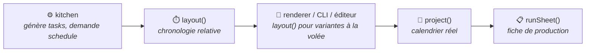

import Since from '../../../../../../components/Since.astro';
import { Steps, LinkCard, CardGrid } from '@astrojs/starlight/components';
import Term from '../../../../../../components/Term.astro';

<Since v="1.4.0" />

`@gram-lang/scheduler` est le composant de Gram qui gère la dimension temporelle : il détermine **à quel moment précis** chaque tâche doit s'exécuter. Jusqu'à la version 1.4.0, cette logique était intégrée au compilateur Kitchen. Elle est désormais isolée dans un paquet dédié, permettant au même moteur de servir le compilateur, le moteur de rendu, le CLI, le serveur de langage (LSP) et vos propres intégrations.

Le scheduler se situe **en dessous** de Kitchen : `@gram-lang/kitchen` dépend de lui, jamais l'inverse. Il n'a aucune connaissance de l'AST, de la syntaxe `.gram` ou de la recette compilée. Son unique point d'entrée est un **graphe de tâches** agnostique ; des tests d'architecture garantissent l'absence absolue de dépendance envers les autres paquets du monorepo.

## Le graphe de tâches

Kitchen génère ce graphe au sein de la recette compilée (`tasks`) : il formalise les données intrinsèques de la recette, indépendamment de toute option d'ordonnancement ou d'affichage :

- **Tâches `prep`** : le travail nécessaire pour préparer une section. Chaque section comporte une tâche de préparation pour rassembler et peser ses ingrédients bruts, plus une tâche par préparation intermédiaire utilisée (`&pâte`), qui ne peut débuter avant que l'intermédiaire ne soit disponible.
- **Tâches `step`** : une tâche par étape, correspondant à la durée de travail actif (manipulations manuelles directes).
- **Tâches `passive`** : les minuteurs passifs d'une étape (cuisson au four, pousse, repos, refroidissement…), avec le décalage auquel ils démarrent et la piste éventuelle pour un équipement dédié (`~_four{}`).
- **Durées structurées** : chaque tâche possède une durée `{ nominal, min?, max? }`. Les bornes `min` et `max` ne sont définies que pour les attentes écrites sous forme de fourchette (`~_{8-16h}`) ; `nominal` représente la durée retenue par défaut (la valeur minimale pour un minuteur passif, maximale pour une tâche active, ou la valeur fixe le cas échéant).
- **Dépendances explicites** : chaque tâche liste les identifiants de celles dont elle dépend (`after`). Les identifiants sont déterministes et lisibles : `s0.prep`, `s1.prep.pâte`, `s0.3`, `s0.3.t0`.
- **Métadonnées de section** : chaque section porte son jour de travail cible (`day`), son échéance en minutes avant la fin lorsqu'elle possède une ancre, et la variable intermédiaire qu'elle produit.

Ce graphe étant totalement indépendant des choix de l'utilisateur, toute combinaison de mise en place et d'élasticité des attentes peut être recalculée à la volée, sans recompiler la recette.

## Deux niveaux de planification

| Niveau | Fonction | Entrée | Sortie |
|---|---|---|---|
| **1. Chronologie théorique** | `layout(graph, options)` | Le graphe de tâches, et optionnellement `{ miseEnPlace, rests }` | Un `Schedule` (blocs ordonnancés, journées relatives, cumuls de temps) et les diagnostics intrinsèques à la recette |
| **2. Projection calendaire** | `project(recipes, context)` | Le ou les graphes, une heure de service, un fuseau horaire et les disponibilités | Un plan horodaté : chaque bloc avec sa date et heure locales, les attentes ajustées, les plages d'indisponibilité et les conflits non résolus |
| | `runSheet(plan \| schedule, options)` | Le plan projeté, ou un `Schedule` seul | Les jours, passages en cuisine et fils d'un <Term id="runSheet" /> (voir ci-dessous) |
| | `findServeTimes()`, `earliestServe()` | Un graphe, un contexte, un intervalle de dates ou « maintenant » | Les heures de service qui conviennent, et la plus tôt |

Ces fonctions sont **strictement pures** : une même entrée produit toujours la même sortie, aucune horloge système ni fuseau implicite n'est consulté, et le graphe d'origine demeure immuable. `project()` accepte par conception une collection de recettes, mais ne planifie pour le moment que la première en signalant le diagnostic `MULTI_RECIPE_UNSUPPORTED`.

## Fonctionnement de `layout()`

Le moteur applique l'algorithme au plus tard décrit dans l'[ordonnancement ALAP](/fr/docs/explanation/alap-scheduling/), articulé en plusieurs passes successives :

<Steps>
1. **Passe arrière (ALAP)**  
   En parcourant les sections de la dernière à la première, chaque étape reçoit l'instant de démarrage le plus tardif possible, calculé d'après les ancres temporelles et les étapes consommatrices de ses préparations.

2. **Résolution des pistes nommées**  
   Deux minuteurs affectés à une même ressource (ex. `~_four{}`) ne peuvent pas se chevaucher. Le plus en amont est automatiquement décalé pour libérer la piste, et une contention (`TRACK_CONTENTION`) est signalée.

3. **Recalage à l'origine**  
   L'ensemble de la chronologie est translaté pour que l'instant initial corresponde exactement à zéro.

4. **Insertion de la mise en place**  
   Le travail de pesée et de préparation associé à chaque groupe de sections est inséré sous forme de blocs de travail dédiés, puis la passe arrière est réexécutée pour que chaque préparation s'achève précisément à l'instant où débute la première étape qui la requiert. Selon l'option choisie :
   - `"perSection"` insère la préparation juste avant chaque section ;
   - `"upfront"` regroupe toutes les préparations au tout début de la recette ;
   - `"perDay"` place les préparations au début de chaque journée de travail.
</Steps>

Les attentes écrites sous forme de fourchette adoptent la stratégie spécifiée via `rests` (`"shortest"`, `"balanced"` ou `"longest"`). Les minuteurs actifs adoptent quant à eux toujours leur durée maximale nominale, garantissant qu'un aléa de préparation ne retarde jamais le service.

## Fonctionnement de `project()`

`project()` commence par ordonnancer le graphe via `layout()`, cale l'instant final sur l'heure de service demandée, puis remonte la chronologie :

- Tout bloc de travail actif débordant sur une plage d'indisponibilité est décalé en allongeant ou en raccourcissant l'attente flexible (écrite sous forme de fourchette) la plus proche en aval.
- L'ordonnancement complet est recalculé à chaque ajustement pour vérifier la validité des dépendances et l'absence de conflit de piste.
- Pour une explication pas à pas, consultez le guide [Planification et plan de marche](/fr/docs/explanation/planning/).

Le temps interne est compté en minutes continues absolues depuis l'époque POSIX. La restitution en heure locale s'appuie sur `Intl.DateTimeFormat` avec un fuseau horaire explicite. Aucun recours à une bibliothèque tierce ou à une horloge système implicite n'est nécessaire : le plan reste strictement identique quel que soit l'environnement hôte, et une journée de 23 ou 25 heures (changement d'heure) est restituée avec sa durée réelle.

## De la chronologie au plan de marche

Le moteur génère des **données structurelles pures** ; le plan de marche constitue l'une des manières de les mettre en scène. La fonction `runSheet()` convertit une chronologie relative ou un plan calendaire en une structure arborescente prête à être restituée par une interface utilisateur, en s'appuyant sur un vocabulaire standardisé :

| Terme | Définition |
|---|---|
| **Journée de travail** | Une journée de travail dédiée à la recette. Seule une ancre temporelle en jours calendaires (`~{-2j}`, déclarée sur une section ou un module `@use`) ouvre une journée distincte. En l'absence d'ancre, la recette se déroule sur une seule journée. |
| **Passage** | Un moment actif en cuisine : une séquence d'étapes de travail manuel ininterrompues par une attente significative (toute pause passive d'au moins 60 minutes, fixée par `VISIT_GAP_MINUTES`, marque la fin du passage). Une journée peut ainsi comporter plusieurs passages. |
| **Fil** | Un processus passif (cuisson, repos, pousse) initié durant un passage et qui se poursuit de manière autonome après votre départ de la cuisine. |
| **Ajustement** | Une durée d'attente allongée ou raccourcie lors de la projection, dans les limites de la fourchette déclarée, afin que les étapes actives coïncident avec vos plages de disponibilité (`avoid-unavailable`). |
| **Problème non résolu** | Un diagnostic émis lors de la projection lorsqu'une contrainte horaire ne peut être satisfaite. |
| **Marge** | La fenêtre temporelle d'anticipation dont dispose un passage s'il est exécuté en avance, en supposant que tous les autres passages soient réalisés aux horaires nominaux prévus. |

Chaque indicateur est calculé par le moteur, sous forme de minutes relatives avant le service, qu'il s'agisse d'une chronologie abstraite ou d'un calendrier horodaté.

La marge d'anticipation quantifie la possibilité d'avancer un passage sans perturber le reste de la recette :
- La planification étant calée au plus tard (ALAP), un passage ne peut qu'être avancé, jamais retardé sans impacter le service ;
- L'avancer réduit l'attente passive précédente et allonge la suivante, dans les limites strictes de leurs fourchettes autorisées ;
- Si un passage prend du retard en pratique, le moteur ne réajuste pas le passé : il suffit de relancer une projection avec une heure cible ou des paramètres actualisés.

Le choix de la restitution relève entièrement de la vue. Le [plan de marche](/fr/docs/how-to/plan-a-meal/) par défaut de Gram découpe une journée dès qu'une pause passive atteint une heure, signale les marges dès 15 minutes, et extrait les ingrédients et le matériel depuis la recette compilée. Une interface tierce peut adopter des règles différentes à partir de ces mêmes données (voir le guide [Créer une interface sur mesure](/fr/docs/how-to/build-custom-ui/)).

### Ce que le moteur ne prend pas en charge

- **Une seule recette à la fois** : La planification coordonnée d'un menu multi-recettes partageant des ressources fera l'objet d'une évolution ultérieure (`MULTI_RECIPE_UNSUPPORTED`).
- **Pas de suivi d'état en direct** : Le moteur est une fonction déterministe pure. En cas de retard imprévu en cuisine, une nouvelle projection doit être invoquée.
- **Aucune décision arbitraire** : Le moteur teste les créneaux soumis (`findServeTimes()` sur vos heures de repas, ou `earliestServe()` calculé dès maintenant) et détaille les motifs d'incompatibilité pour les créneaux rejetés.

## Deux familles de diagnostics

Le moteur distingue rigoureusement deux catégories d'anomalies :

- **Diagnostics intrinsèques à la recette** : identifiés dès l'ordonnancement par `layout()` (`TIME_PARADOX`, `TRACK_CONTENTION`, `DAY_OVERFLOW`). Kitchen les transforme en avertissements de compilation (`WarningCode`), avec titre de section et ligne source pour l'éditeur.
- **Diagnostics contextuels de projection** : issus de la confrontation avec l'heure de service et vos disponibilités (`ACTIVE_OUTSIDE_AVAILABILITY`, `ACTIVE_BLOCK_EXCEEDS_AVAILABILITY`, `DAY_MISMATCH`, `START_IN_PAST`, `MULTI_RECIPE_UNSUPPORTED`). Portés par le résultat de `project()`, ils ne constituent pas des erreurs de compilation.

## Intégration dans le pipeline

Les vues de restitution (le plan de marche ou vos composants personnalisés) consomment directement ces structures de données. Pour explorer les signatures de fonctions et leurs types TypeScript, consultez la [référence de l'API scheduler](/fr/docs/reference/api/scheduler/).

## Ressources associées

<CardGrid>
  <LinkCard
    title="Planification et plan de marche"
    description="Mise en place, recettes multi-jours, projection calendaire et fiches de production."
    href="/fr/docs/explanation/planning/"
  />
  <LinkCard
    title="Ordonnancement ALAP"
    description="Comprenez l'algorithme rétrograde qui optimise les tâches actives et passives."
    href="/fr/docs/explanation/alap-scheduling/"
  />
  <LinkCard
    title="Planifier un repas"
    description="Guide pas-à-pas pour générer un plan de marche avec la CLI ou dans votre agenda."
    href="/fr/docs/how-to/plan-a-meal/"
  />
  <LinkCard
    title="Référence de l'API scheduler"
    description="Signatures de fonctions, options et types TypeScript pour layout(), project() et runSheet()."
    href="/fr/docs/reference/api/scheduler/"
  />
</CardGrid>
