import Since from '../../../../../components/Since.astro';
import { Steps, LinkCard, CardGrid } from '@astrojs/starlight/components';
import Term from '../../../../../components/Term.astro';

<Since v="1.4.0" />

Une recette décrit **ce dont elle a besoin** et **comment réaliser chaque geste** : des ingrédients, du matériel, des manipulations et des durées. Mais elle ne dicte pas votre organisation.

Changer de stratégie de planification ne modifie jamais les ingrédients requis, la liste de courses, le temps de préparation estimé ni le temps de travail effectif. Cela réorganise uniquement la chronologie des interventions pour s'adapter à votre rythme et à vos disponibilités.

## Trois notions, un seul choix

Pour bien comprendre comment Gram articule le temps, distinguons trois aspects :

| Notion | Rôle | Modifié par la planification ? |
|---|---|---|
| **Ingrédients** | La matière première requise par chaque section et la liste de courses consolidée. | Non |
| **Mise en place** | Le travail de préparation amont : peser, laver, éplucher, découper. Chaque section annonce son coût estimé (`miseEnPlace`). | Non |
| **Planning** | La disposition temporelle des tâches : chronologie relative, durée totale et <Term id="runSheet" />. | **Oui**, c'est l'unique dimension modifiée. |

Gram déduit automatiquement ces éléments à partir de votre code source. Vous n'avez rien à recalculer manuellement.

## Les trois stratégies de mise en place

Considérons une recette simple composée d'une pâte et d'une garniture :

```gram
## Pâte ->&pâte

[Mélanger] La @farine{500g} et l'@eau{300ml} dans un #saladier.

[Pointer] Laisser reposer ~_{30min}.

## Garniture ->&garniture

[Émincer] Les @oignons{200g}(finement émincés).

## Montage

[Assembler] La &pâte et la &garniture, puis cuire ~{25min}.
```

Gram estime le travail préparatoire de chaque section selon ses ingrédients et son matériel (ici : 3 min pour la pâte, 3 min pour la garniture, 2 min pour le montage, soit 8 min au total). Le temps actif cumulé est de 29 minutes dans tous les cas.

Trois options permettent d'ordonnancer cette préparation :

### 1. Par section (`perSection`, par défaut)

La préparation de chaque section se place au plus près de son exécution. Dès qu'un temps passif se présente (repos, fermentation, cuisson), Gram y insère la préparation de l'étape suivante en **temps masqué** : le travail actif réalisé *pendant* une attente n'ajoute aucune minute au temps global.

```mermaid
gantt
    title Par section — Temps masqué optimisé (1 h 00)
    dateFormat  HH:mm
    axisFormat %H:%M
    todayMarker off
    section Pâte
    Mise en place                     : p1, 00:00, 3m
    Mélanger                          : active, a1, 00:03, 2m
    Repos (passif)                    : r1, 00:05, 30m
    section Garniture
    Mise en place                     : p2, 00:28, 3m
    Émincer                           : active, a2, 00:31, 2m
    section Montage
    Mise en place                     : p3, 00:33, 2m
    Assembler et cuire                : active, a3, 00:35, 25m
```



La pâte repose pendant 30 minutes. Vers la fin de ce repos (dès 00:28), la garniture et le montage sont préparés juste à temps : les découpes restent fraîches sans encombrer inutilement le plan de travail, et la durée globale est minimale (**1 h 00**).

### 2. Tout au début (`upfront`)

L'ensemble des pesées et découpes des ingrédients bruts est regroupé avant d'entamer la première manipulation :

```mermaid
gantt
    title Tout au début — Préparation groupée (1 h 03)
    dateFormat  HH:mm
    axisFormat %H:%M
    todayMarker off
    section Mise en place
    Pâte                              : p1, 00:00, 3m
    Garniture                         : p2, 00:03, 3m
    section Pâte
    Mélanger                          : active, a1, 00:06, 2m
    Repos (passif)                    : r1, 00:08, 30m
    section Garniture
    Émincer                           : active, a2, 00:34, 2m
    section Montage
    Récupérer les préparations        : p3, 00:36, 2m
    Assembler et cuire                : active, a3, 00:38, 25m
```



La pâte et la garniture sont préparées dès 00:00. La durée totale passe à **1 h 03**, la préparation de la garniture n'étant plus absorbée en temps masqué. Ce mode séduit celles et ceux qui préfèrent faire place nette sur le plan de travail avant d'allumer les feux.

### 3. Par journée de travail (`perDay`)

La mise en place est regroupée au début de chaque journée de travail. Pour une recette exécutée le jour même, ce mode produit le même résultat que « Tout au début ». Il prend toute sa valeur pour les recettes échelonnées sur plusieurs jours.

:::note[Gestion des préparations intermédiaires]
Un ingrédient intermédiaire (`&pâte`) n'existe pas au début de la recette : il ne peut pas être préparé avant d'avoir été confectionné. Quel que soit le mode choisi, sa récupération ou son pesage est toujours imputé à la section qui le **consomme**, et planifié au moment précis où cette étape intervient.
:::

## Configuration sur l'ensemble des outils

Gram applique une règle stricte : la recette ne contient aucune consigne d'affichage ni d'ordonnancement figé. Elle n'énonce que des faits culinaires. C'est l'utilisateur qui choisit son mode de mise en place et la stratégie de repos au moment de la consultation ou du rendu :

| Outil | Mise en place | Stratégie de repos |
|---|---|---|
| **CLI** (`gram view`, `plan`, `export`, `print`) | `--mise-en-place <per-section\|upfront\|per-day>` | `--rests <shortest\|balanced\|longest>` |
| **VS Code** | Réglage `gram.miseEnPlace` | Réglage `gram.rests` |
| **Playground** | Sélecteur « Mise en place » | Sélecteur « Repos » |
| **Renderer** (`@gram-lang/renderer`) | Option `miseEnPlace` | Option `rests` |

Dans le JSON compilé, `schedule` contient l'ordonnancement par défaut (par section, repos au plus court). Toute variante est calculée à la volée à partir de `tasks` via la fonction pure `layout()` de `@gram-lang/scheduler`, sans nécessiter de recompiler la recette.

## Fourchettes de repos et élasticité

Une attente passive peut être fixe (`~_{12h}`) ou exprimée sous forme de **fourchette** (`~_{12-24h}`).

Une fourchette indique une plage acceptable : le produit est prêt dès 12 heures, et reste optimal jusqu'à 24 heures. Cette marge d'élasticité donne à Gram la liberté d'ajuster le planning sans dénaturer la recette :

- **Sur une chronologie théorique**, l'option `rests` sélectionne le comportement par défaut :
  - `shortest` (par défaut) : retient la borne la plus courte ;
  - `balanced` : retient la valeur médiane ;
  - `longest` : retient la borne maximale.
- **Lors de la projection sur le calendrier**, cette élasticité permet au moteur d'allonger ou de raccourcir une attente pour éviter de vous faire cuisiner en pleine nuit.

Les minuteurs actifs écrits en fourchette (`~{40-50min}`) expriment quant à eux une incertitude de cuisson : ils sont toujours planifiés sur leur valeur maximale nominale pour garantir que le repas ne soit jamais servi en retard.

## Recettes sur plusieurs jours et ancres temporelles

Une recette longue (pain au levain, brioche, pâte feuilletée, saumon mariné) s'organise naturellement sur plusieurs journées de travail.

```gram
---
title: Tarte garnie
---

## Crème ~{-3d} ->&crème

[Fouetter] Le @lait{500ml} et les @œufs{4}.

[Refroidir] Laisser prendre à ^{4C} pendant ~_{24h}.

## Fond ->&fond

[Travailler] La &crème{150g} avec la @farine{300g} et le @beurre{150g}.

## Tarte ~{-1d}

[Garnir] Avec le &fond{400g}.

[Cuire] Pendant ~{30min}.

## Service

[Saupoudrer] De @sucre{10g}.
```

Pour découper une recette en journées distinctes, deux principes simples s'appliquent :

1. **Seule une ancre en jours (`~{-Nd}`) ouvre une journée de travail.** Une valeur comme `~{-1d}` ou `~{-2d}` exprime une intention claire (*« préparation faite la veille (J-1) »* ou *« deux jours avant (J-2) »*). À l'inverse, une ancre en heures (`~{-18h}`) ou un temps passif long (`~_{24h}`) décale bien les tâches vers l'amont mais n'ouvre pas de journée calendaire autonome.
2. **Une section sans ancre se rattache à l'ancre qui la suit.** L'algorithme raisonnant à rebours depuis le service, une section non ancrée est planifiée au plus tard, c'est-à-dire le même jour que la section ancrée située après elle. Dans l'exemple ci-dessus, le fond n'a pas d'ancre : il est donc confectionné à **J-1**, juste avant la tarte.

Pour cette recette, Gram produit naturellement ce découpage :

```text
J-3      ▮ ~ 5min        Crème
         ┆ Crème : Refroidir 1j
J-1      ▮ ~ 40min       Fond, Tarte
Jour J   ▮ ~ 5min        Service
         ★               Servir
```

:::tip[Enchaîner des sections le même jour]
Lorsque plusieurs sections se suivent au cours de la même journée, ancrez uniquement la dernière (`## Tarte ~{-1d}`). Les sections précédentes s'y rattachent naturellement sans risque de conflit.
:::

Chaque journée de travail s'inscrit dans une fenêtre théorique de 24 heures. Si une très longue attente passive repousse les étapes actives d'une journée en amont de cette fenêtre, Gram émet l'avertissement de compilation `DAY_OVERFLOW` et conseille d'ancrer la section un jour plus tôt (`~{-2d}`).

## Projection en heures réelles

Une chronologie relative indique combien de temps dure la recette. Pour savoir **quand commencer**, Gram confronte ce modèle à trois paramètres :

1. **Votre heure de service cible** (`--serve "2026-10-18 13:00"`).
2. **Votre fuseau horaire** (`--tz Europe/Paris`, ou paramètre `timezone` du projet).
3. **Vos plages de disponibilité** (`--available`, ou paramètre `availability` du projet).

### Définir vos disponibilités

La syntaxe des disponibilités est concise et flexible :
- `08:00-22:00` : plage quotidienne par défaut ;
- `sat=09:00-23:00` : exception pour un jour de semaine (`mon` à `sun`) ;
- `2026-10-09=none` : indisponibilité totale pour une date précise ;
- `22:00-02:00` : une plage dont l'heure de fin précède le début traverse minuit en continu.

Une date précise prime sur une règle de jour de semaine, qui prime elle-même sur la règle quotidienne.

:::note[Fuseaux et changements d'heure]
Les calculs internes s'effectuent en minutes absolues continues. Une pousse de 24 heures traversant la nuit du passage à l'heure d'hiver dure 24 heures réelles : si elle débute à 14 h la veille, elle s'achèvera donc à 13 h locale. Aucune approximation liée au fuseau n'altère la justesse du résultat culinaire.
:::

### Comment Gram préserve vos nuits

Le moteur cale d'abord la fin de la recette sur l'heure du service, puis remonte la chronologie :

<Steps>
1. **Détection des chevauchements**  
   Les tâches actives qui s'enchaînent sans pause forment des blocs continus indivisibles. Tout bloc qui déborde sur une plage d'indisponibilité (par exemple entre 22 h et 8 h) est repéré.

2. **Ajustement via les attentes élastiques**  
   Pour replacer le travail actif dans vos heures disponibles, Gram allonge ou raccourcit l'attente élastique (`~_{8-16h}`) la plus proche en aval. Allonger un repos fait avancer la préparation à la veille au soir ; le raccourcir la décale au lendemain matin.

3. **Validation rigoureuse**  
   L'ordonnancement complet est recalculé à chaque ajustement. Gram ne sort jamais des bornes autorisées de la fourchette et ne modifie aucun temps fixe.
</Steps>

### Exemple : la pousse de nuit

```gram
## Pâte ->&pâte

[Pétrir] La @farine{500g} avec l'@eau{350ml} pendant ~{20min}.

[Pointer] Laisser reposer ~_{8-16h}.

## Cuisson

[Cuire] Façonner la &pâte{850g} et cuire ~{30min}.
```

Pour un repas le dimanche à 13 h avec des disponibilités de `08:00-22:00`, une pousse minimale de 8 heures placerait le pétrissage en pleine nuit (à 4 h 10 du matin). 

Grâce à la fourchette `8-16h`, Gram allonge automatiquement la pousse à 14 h 30 : le pétrissage est ainsi avancé au samedi soir à 21 h 40 pour se terminer à 22 h pile, juste avant votre coucher.

```text
SAM. 10  ▮ 21:40 – 22:00 Pâte
         ┆ Pâte : Pointer 14h 30min (prévu 8h à 16h)
DIM. 11  ▮ 12:30 – 13:00 Cuisson
         ★ 13:00         Servir
```

## Du calendrier au plan de marche

La projection calendaire produit toutes les données nécessaires à l'action en cuisine. Le <Term id="runSheet" /> les met en scène :

- **Passages en cuisine (`▮`)** : chaque période de présence active, avec l'heure de début, la fin prévue et la marge disponible (« Possible dès... »).
- **Fils passifs d'attente (`┆`)** : les cuissons ou repos qui se poursuivent sans vous pendant que vous quittez la cuisine.
- **Mise en place détaillée** : pour chaque passage, les ingrédients à peser, les préparations à sortir du réfrigérateur et le matériel requis.

Sans heure de service (`gram plan recette.gram`), Gram génère un plan de marche relatif sous forme de compte à rebours (`J-2`, `J-1`, `Jour J`) avec les durées estimées par journée et l'heure de dégustation la plus précoce (`earliestServe`) si vous démarrez immédiatement. Les marges et ajustements horaires n'interviennent que lorsque vous fixez une heure de service.

### Diagnostics et contraintes non résolues

Lorsque des contraintes réelles ne peuvent pas être satisfaites (disponibilités trop restreintes, durée d'attente fixe imposant du travail nocturne), Gram ne dissimule rien. Il affiche les alertes dans un bloc **« À régler »** :

| Diagnostic | Signification | Piste de résolution |
|---|---|---|
| `ACTIVE_OUTSIDE_AVAILABILITY` | Du travail actif tombe hors de vos plages disponibles sans qu'aucun repos ne puisse être ajusté. | Élargir vos disponibilités ou assouplir la fourchette de repos. |
| `ACTIVE_BLOCK_EXCEEDS_AVAILABILITY` | Un bloc de travail continu dépasse la taille de votre plage de disponibilité. | Prolonger votre plage de disponibilité pour accueillir ce geste ininterruptible. |
| `DAY_MISMATCH` | Un travail a été décalé sur une autre date calendaire que celle prévue (par exemple du travail sans ancre glissé à la veille). | Informatif : le plan reste valide, ou ancrez explicitement la section si souhaité. |
| `START_IN_PAST` | La première étape aurait dû débuter avant l'instant présent. | Décaler l'heure de service ou raccourcir les repos. |
| `MULTI_RECIPE_UNSUPPORTED` | Plusieurs recettes ont été fournies simultanément ; seule la première est planifiée. | Planifier les recettes individuellement. |

:::note[Alertes de planning vs erreurs de recette]
Ces diagnostics dépendent uniquement de **votre contexte calendaire** : ils n'indiquent aucune erreur dans le fichier `.gram` de la recette.
:::

## Pour aller plus loin

<CardGrid>
  <LinkCard
    title="Planifier un repas"
    description="Guide pas-à-pas : commandes CLI, export Markdown et synchronisation avec votre agenda électronique."
    href="/fr/docs/how-to/plan-a-meal/"
  />
  <LinkCard
    title="Ordonnancement ALAP"
    description="Comprenez l'algorithme rétrograde qui optimise l'enchaînement des étapes en cuisine."
    href="/fr/docs/explanation/alap-scheduling/"
  />
  <LinkCard
    title="Le moteur d'ordonnancement"
    description="Architecture du paquet @gram-lang/scheduler, graphe de tâches et fonctions pures."
    href="/fr/docs/explanation/engine/scheduler/"
  />
  <LinkCard
    title="Référence de l'API scheduler"
    description="Documentation des types TypeScript et des fonctions layout(), project() et runSheet()."
    href="/fr/docs/reference/api/scheduler/"
  />
</CardGrid>
